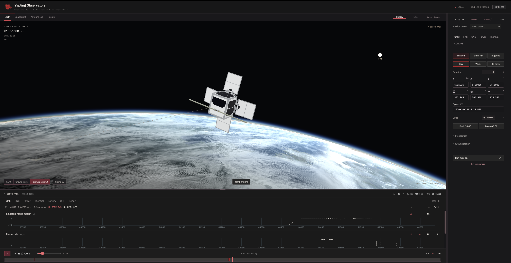

# Yapling Observatory

A CubeSat mission simulator for studying radio links, pointing, power and temperature over passes or longer missions.
To take a peek at where these models came from take a peek at [Model references](services/simulator/REFERENCES.md).

| Area | Models and tools |
| --- | --- |
| Orbit | RK4, symplectic integration, J2, ground tracks |
| Radio | Antenna patterns, QPSK and 8PSK MODCODs, LoRa beacons, link budgets |
| GNC | Reaction wheels, magnetorquers, pointing and momentum unloading |
| Power | Solar generation, battery charge, voltage and current |
| Thermal | Coupled bus, battery and panel temperatures |
| Results | Live runs, replay, plots, pass reports and saved missions |

With [Python 3.11+](https://www.python.org/downloads/) and [Node.js 22.12+](https://nodejs.org/en/download) installed, run from the extracted project folder:

```sh
python3 start.py
```

Tested on macOS, Linux and Windows. First launch prepares the app and opens your browser. Ctrl-C stops it.

[Local setup](services/simulator/README.md#run-locally) · [Music credits](apps/web/public/audio/CREDITS.md)


